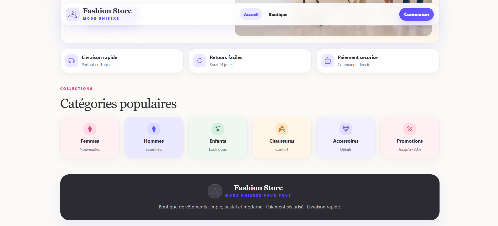
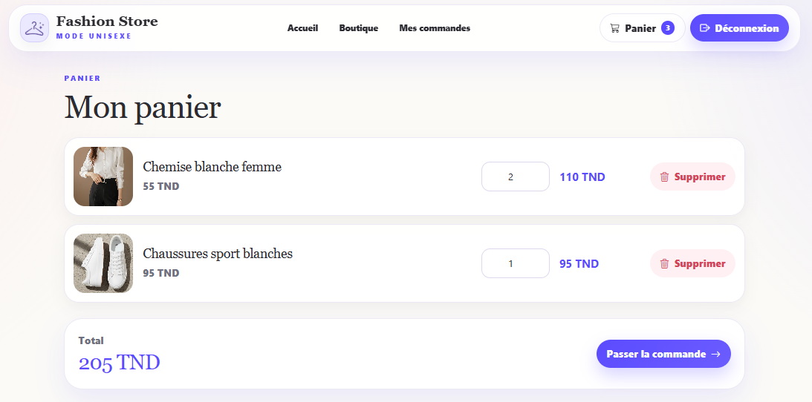
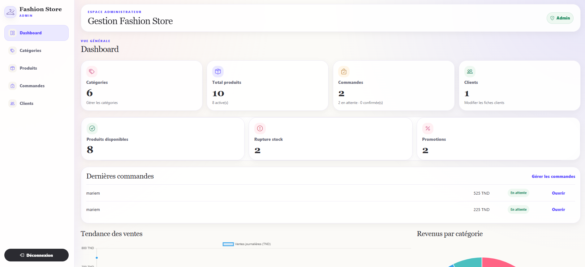

# 🛍️ NovaStore — Full-Stack E-Commerce Application

**A full-stack e-commerce application built with Angular, Node.js, Express, PostgreSQL, and Prisma ORM.**

NovaStore provides a responsive online shopping experience with customer authentication, product browsing, shopping cart management, order processing, and a role-protected administration dashboard.

Originally developed as a collaborative academic project, NovaStore was later modernized with a dedicated REST API, relational database, JWT authentication, and automated testing.

## 📸 Preview





### 🛍️ Product Catalog


### 🛒 Shopping Cart


### 🔐 Admin Dashboard


## ✨ Features

**Customer**
- Secure registration and login
- Product catalog with search and filters
- Product details and shopping cart
- Checkout and order history

**Administrator**
- Protected dashboard
- Product and category management (CRUD)
- Product image uploads
- Customer and order management
- Order status and stock management

**Security**
- JWT authentication and bcrypt password hashing
- Role-based access control (CLIENT / ADMIN)
- Protected REST endpoints and input validation

## 🛠️ Tech Stack

| Frontend | Backend | Database | Tools |
|---|---|---|---|
| Angular, TypeScript, Bootstrap | Node.js, Express, JWT | PostgreSQL, Prisma ORM | Git, GitHub Actions, Jasmine, Karma |

## 🏗️ Architecture

```text
Angular Frontend
      |
      | REST API
      v
Node.js / Express
      |
      v
Prisma ORM
      |
      v
PostgreSQL
```

## 🚀 Getting Started

### Prerequisites

Node.js, npm and PostgreSQL.

### Installation

```bash
git clone https://github.com/kammariem/novastore-angular.git
cd novastore-angular
npm install
```

Create a local `.env` file based on `.env.example` and configure your PostgreSQL connection and JWT secret.

```bash
npm run prisma:generate
npm run db:migrate
npm run db:seed
```

Start the backend:

```bash
npm run api
```

Start Angular in another terminal:

```bash
npm start
```

Open `http://localhost:4200`.

## 🧪 Testing

```bash
npm run build
npm run test:api
npm test -- --watch=false --browsers=ChromeHeadless
```

Latest local validation:
- **32 Angular tests passed**
- **25 API tests passed**
- Customer and administrator workflows tested against an isolated PostgreSQL schema

## 📌 Project Status

The core e-commerce features are implemented and validated locally.

The project remains under development. Dependency security updates and deployment hardening are planned before public hosting.

## 👩‍💻 Development Background

NovaStore builds on an initial collaborative academic project. Its subsequent modernization focused on REST API development, PostgreSQL/Prisma integration, JWT authentication, server-side authorization, order processing, and automated testing.

## 📄 License

No open-source license has been specified.